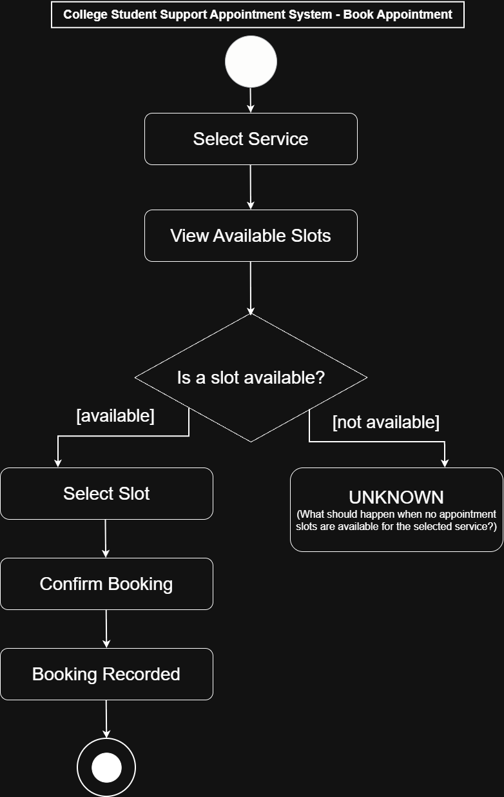
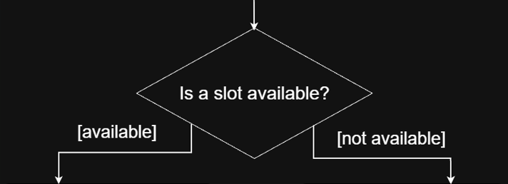

# Activity Diagram

## Contents

1. [Process Modelled](#1-process-modelled)
2. [Purpose](#2-purpose)
3. [Activities](#3-activities)
4. [Decision and Guards](#4-decision-and-guards)
5. [Unknowns](#5-unknowns)
6. [Stakeholder Questions](#6-stakeholder-questions)
7. [Modelling Decision](#7-modelling-decision)

*[Back to README](/README.md)*

## 1. Process Modelled

The activity diagram expands on use case [**UC-02, "Book appointment"**](/04-requirements-modelling/use-case-notes.md#5-use-case-narrative). The activity is performed by the **Student** actor.
 It models the booking activity from selecting a support service to the booking being recorded.

## 2. Purpose

**Why *this* use case:**  As mentioned in [FR-04](/03-requirements-analysis/requirements.md#4-functional-requirements), this is the core functionality of the system.

**Why an activity diagram:**  It helps to validate that the process makes sense in use and also helps to identify missing information.

## 3. Activities

| Activity | Performed by | Related requirement |
|---|---|---|
| Select Service | Student | FR-02 (Candidate), FR-03 |
| View Available Slots | Student | FR-01, FR-02 (Candidate) |
| Select Slot | Student | FR-04 |
| Confirm Booking | Student | FR-04 |
| Booking Recorded | System | FR-04, FR-18 (Candidate) |

## 4. Decision and Guards

**Decision:**

The "diamond" asks the question "Is a slot available?"

**Guards:**

* Available:
    If there is a slot available, the booking then goes ahead with the next steps; the slot is selected, the booking then confirmed and finally, it gets recorded by the system.

* Not available:
    The flow leads to an UNKNOWN note, because the scenario does not say what should happen (see sections 5 and 6).

The two guards cover every possible case and cannot both be true at the same time, so the flow is never unclear about which path to follow.

## 5. Unknowns

* **No available slots ("[not available]" guard):** The scenario does not specify what should happen when a service has no open appointment slots. For example, whether the student is placed on a waitlist, shown alternative services/support staff, offered different appointments that are available to book or simply prompted to try again later (FR-01, FR-04).
* **Same slot picked at the same time:** It is not clear what happens if two students choose the same slot before confirming or if a slot gets taken just before confirmation (FR-04, FR-18 (Candidate)).
* **Slot visibility update rule:** Whether a booked slot should immediately stop being shown as available to other students was only implied by the double-booking problem, so it was added as candidate functional requirement (FR-18) and still needs stakeholder confirmation (FR-18 (Candidate)).
* **Student booking limits:** It is unknown whether a student can repeat this booking flow to hold multiple active appointments at once or if there is a cap per service, cap per week or cap per student (FR-04).

## 6. Stakeholder Questions

*"Who to ask" is based on the stakeholders identified during discovery. Their actual responsibilities are assumptions and need to be confirmed.*

| Question | Who to ask | Why them |
|---|---|---|
| What should happen if a student picks a service with no available slots? | Management | They set the rules for how services run and what students can do when no slots are free. |
| Should a booked slot be hidden from other students straight away? | Management/Support staff/Administrative staff (potential role, to be confirmed) | They have the knowledge on how each support service runs its appointments and whether slots are strictly for one student at a time. |
| What should happen if two students try to book the same slot at the same time before either confirms? | Management/Support staff | They decide how booking clashing should be handled for students. |
| Can a student repeat this booking flow to hold multiple active appointments at once or is there a limit per student or per service? | Management | They set the college wide rules on how many appointments a student is allowed to book. |

## 7. Modelling Decision

On the "[not available]" branch I used an "UNKNOWN" note instead of inventing a solution like a waitlist. The scenario does not state what should happen when no slots are free and guessing a feature could lead to building something that the stakeholders never asked for. Instead, I kept the main diagram strictly to what is supported and explored a possible option in the use case narrative ([alternative flow - 2a (Candidate)](/04-requirements-modelling/use-case-notes.md#5-use-case-narrative)). 

---
*[Back to top](#contents) | [Back to README](/README.md)*