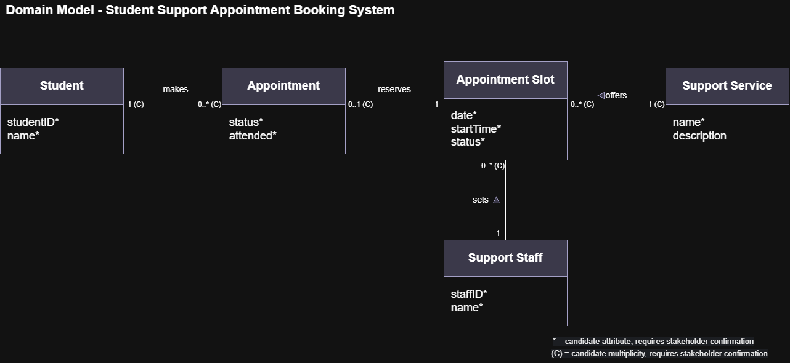

# Conceptual Class Diagram (Domain Model)

## Contents

1. [Diagram](#1-diagram)
2. [Domain Concepts](#2-domain-concepts)
3. [Associations and Multiplicities](#3-associations-and-multiplicities)
4. [Requirements-to-Model Check](#4-requirements-to-model-check)
5. [Open Questions](#5-open-questions)
6. [Reflection](#6-reflection)

*[Back to README](/README.md)*

## 1. Diagram

## 2. Domain Concepts

| Concept | Description | Attributes | Supporting requirement(s) |
|---|---|---|---|
| **Student** | An authenticated student who views services and makes or cancels appointments. | "studentID*", "name*" | FR-01, FR-04, FR-07 |
| **Appointment** | A student's booking for a specific slot, including whether they attended it. | "status*", "attended*" | FR-04, FR-07, FR-13 (Candidate) |
| **Appointment Slot** | An available or blocked time slot on a service schedule that exists before a booking is made. | "date*", "startTime*", "status*" | FR-01, FR-10, FR-11 (Candidate), FR-18 (Candidate) |
| **Support Staff** | Staff member who sets their available slots, block out times and record non-attendance. | "staffID*", "name*" | FR-10, FR-11 (Candidate), FR-13 (Candidate) |
| **Support Service** | A college support department offering appointments with its own description. | "name*", "description" | FR-03 |
*\* = candidate attribute, requires stakeholder confirmation.*

I used "Appointment" and "Appointment Slot" as two separate concepts, because a slot already exists before anyone books it.

### Considered but not modelled as classes:

* **Management** -  an actor/role; no information about it is stored (FR-14)
* **Report** - derived from appointment data, not stored separately (FR-14)
* **Availability / block out** - actions performed by support staff (FR-10, FR-11 (Candidate))
* **Reminder / confirmation** - system actions, not domain concepts (FR-05, FR-09)

## 3. Associations and Multiplicities

| Association | Multiplicity | Status | Requirement evidence |
|---|---|---|---|
| Student makes -> Appointment | 0..* (C) | Candidate | FR-04 allows a student to book a slot but the scenario does not confirm if a student can hold zero or multiple active appointments at once. |
| Appointment <- made by Student | 1 (C) | Candidate | FR-04 and FR-16 (Candidate) describe an individual authenticated student making a booking but it is unconfirmed if a booking can ever be shared or made on someone else's behalf. |
| Appointment reserves -> Slot | 1 | Supported | FR-04 states that a student books *"an available appointment slot"* (one slot per appointment). |
| Slot <- reserved by Appointment | 0..1 (C) | Candidate | FR-01 and FR-18 (Candidate) imply a slot is either free ("0") or taken by one booking ("1"). Whether there is a need for group sessions that shall allow multiple bookings per slot needs confirmation.  |
| Service offers -> Slot | 0..* (C) | Candidate | FR-01 and FR-03 imply a support service can have zero or many available slots but this is not explicitly stated in the scenario. |
| Slot <- offered by Service | 1 (C) | Candidate | FR-02 (Candidate) and FR-03 link slots to a specific service but whether a slot could ever belong to more than one service is unconfirmed. |
| Staff sets -> Slot | 0..* (C) | Candidate | FR-10 states support staff set *"their available appointments"*, which implies zero or many slots, though it is not confirmed. |
| Slot <- set by Staff | 1 | Supported | FR-10 states an authorised support staff member sets *"their available appointments"*, tying each slot to that staff member. |
*(C) = candidate multiplicity, requires stakeholder confirmation.*

## 4. Requirements-to-Model Check

See [requirements.md](/03-requirements-analysis/requirements.md) for the requirements tables.

| Requirement | Where in the diagram | Represented? |
|---|---|---|
| **FR-01** | "Appointment Slot" ("status*") and its links to "Support Service" | Partially ('Viewing' is an action shown in the [Use Case](/04-requirements-modelling/use-case-notes.md#1-diagram---student-support-staff-and-management---appointment-booking) and [Activity diagrams](/04-requirements-modelling/activity-notes.md#1-process-modelled)) |
| **FR-03** | "Support Service" class and its "description" attribute | Yes |
| **FR-04** | "Student" makes "Appointment" which reserves "1" "Appointment Slot" | Yes |
| **FR-07** | "Appointment" ("status*") and "Appointment Slot" ("status*") | Partially (cancelling is a process step rather than a static concept) |
| **FR-10** | "Support Staff" sets "Appointment Slot" | Yes |
| **FR-11** (Candidate) | "Appointment Slot" ("status*") managed by "Support Staff" | Needs clarification (whether "blocked out" is a slot status or separate rule) |
| **FR-13** (Candidate) | "Appointment" ("attended*") | Needs clarification (exact states and whether staff is linked directly to "Appointment") |
| **FR-18** (Candidate) | "0..1 (C)" on the "Appointment" end of "reserves" and "status*" on "Appointment Slot" | Needs clarification (marked candidate until confirmed by stakeholders) |

## 5. Open Questions

Who to ask is based on stakeholders identified in [discovery](/01-discovery/discovery.md#4-stakeholders--potential-stakeholders) and their responsibilities are assumptions.

| Question | Who to ask | Related requirement |
|---|---|---|
| Can a student hold multiple active bookings at the same time ("0..*") or is there a limit per student or per service? | Management | FR-04 |
| Is each slot strictly limited to one booking ("0..1") or can group sessions allow multiple students in the same slot? | Management | FR-04, FR-18 (Candidate) |
| When a student cancels an appointment and another student books that slot later, should the system keep the cancelled "Appointment" record along with the new one ("0..*")? | Management / IT Administrator (Potential) | FR-07, FR-14 (Candidate) |
| Does a support staff member record non-attendance directly on an "Appointment" or only through the "Appointment Slot" they set? | Support staff | FR-10, FR-13 (Candidate) |
| Is blocking out a time handled as a "status" on "Appointment Slot" (for example; available, booked, blocked) or does it work differently? | Support staff | FR-11 (Candidate) |
| Does management only need statistics generated from appointments or do reports need to be saved as their own records? | Management | FR-14 (Candidate) |

## 6. Reflection

---
*[Back to top](#contents) | [Back to README](/README.md)*