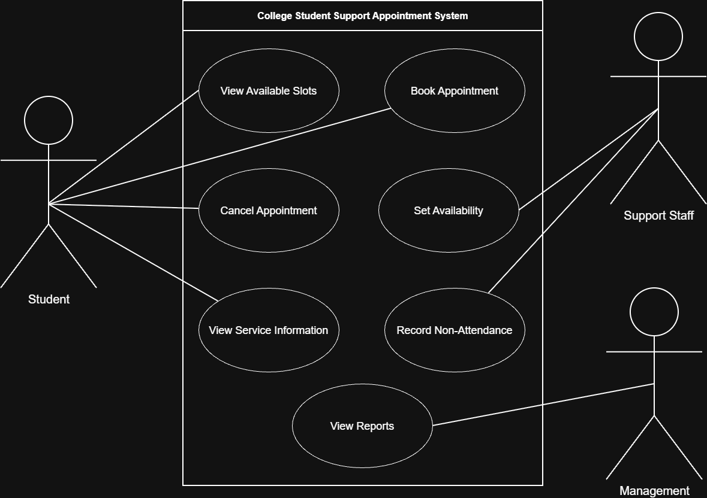

# UML Use Case Diagram

## Diagram - Student, Support staff and Management - Appointment Booking

## Requirements used

The diagram is based on the functional requirements identified in the requirements analysis document.

These include:
* **FR01** -  The system shall allow an authenticated student to view available support appointment slots.
* **FR03** - The system shall display a description of each support service to help students choose the appropriate one.
* **FR04** - The system shall allow an authenticated student to book an available appointment slot.
* **FR07** - The system shall allow a student to cancel a booked appointment.
* **FR10** - The system shall allow an authorised support staff memeber to set their available appointments.
* **FR11** - The system shall allow an authorised staff member to block out times, which should then not display to students as available.
* **FR13** - The system shall allow an authorised staff member to record that a student did not attend an appointment.
* **FR14** - The system shall allow authorised management users to view reports on service demand and attendance.

### Actors

**Student**

The student is an authorised user who needs to be able to view available appointment slots, information regarding the support service, and need to be able to book and also cancel appointments.

**Support Staff**

The support staff needs to be able to set their available appointments and record no-shows.

**Management**

Management needs to be able to view records on bookings, including cancellation and no-shoe rates.

### Use Cases

* View available appt. slots - Allows authorised users to check what appointment slots are available to book.
* Book an appointment - Allows and authorised user to book one of the available appointment slots.
* Cancel an appointment - Allows a user with an existing booking to cancel said booking.
* View service information/description - Allows authorised users to view the description section pertaining to different departments.
* Set appointment availability - Allows users who have support staff authorisation to set their own availability for specific days/times.
* Record non-attendance - Allows support staff to record in the system if a student did not show up for a scheduled appointment.
* View reports - Allows authorised management personnel to check reports on statistics about all bookings and attendance rates.

### Unknowns / Questions

The exact permissions for student, support staff and management are not fully defined. For example, it is not yet clear whether support staff members should be able to set their own available appointments, or if that would be the job of the management staff. It is also not clearly defined, what reports if any does the management staff needs.