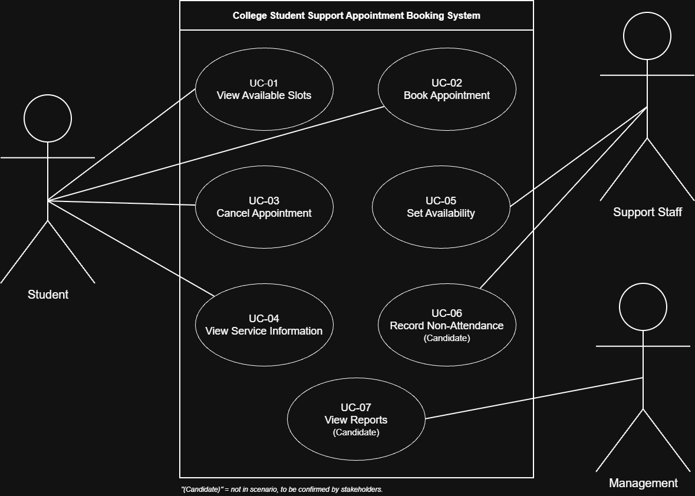

# UML Use Case Diagram

## Contents

1. [Diagram](#1-diagram---student-support-staff-and-management---appointment-booking)
2. [Requirements used](#2-requirements-used)
3. [Actors](#3-actors)
4. [Use Cases](#4-use-cases)
5. [Use Case Narrative](#5-use-case-narrative)
6. [Unknowns / Questions](#6-unknowns--questions)

*[Back to README](/README.md)*

## 1. Diagram - Student, Support staff and Management - Appointment Booking

## 2. Requirements used

The diagram is based on the functional requirements identified in the [requirements analysis](/03-requirements-analysis/requirements.md) document.

These include:
* **Student - View available slots**
    * **FR-01** - The system shall allow an authenticated student to view available support appointment slots.
* **Student - View service information**
    * **FR-03** - The system shall display a description of each support service to help students choose the appropriate one.
* **Student - Book appointment**
    * **FR-04** - The system shall allow an authenticated student to book an available appointment slot.
* **Student - Cancel appointment**
    * **FR-07** - The system shall allow a student to cancel a booked appointment.
* **Support staff - Set availability**
    * **FR-10** - The system shall allow an authorised support staff member to set their available appointments.
* **Support staff - Set availability**
    * **FR-11** - The system shall allow an authorised support staff member to block out times, which shall then not display to students as available.
* **Support staff - Record non-attendance**
    * **FR-13** - The system shall allow an authorised support staff member to record that a student did not attend an appointment.
* **Management - View reports**
    * **FR-14** - The system shall allow authorised management users to view reports on service demand and attendance.

## 3. Actors

**Student**

The student is an authorised user who needs to be able to view available appointment slots, information regarding the support service, and need to be able to book and also cancel appointments.

**Support Staff**

The support staff needs to be able to set their available appointments and record no-shows.

**Management**

Management needs to be able to view records on bookings, including cancellation and no-show rates.

## 4. Use Cases

| ID | Use case | Actor | Description |
|---|---|---|---|
| UC-01 | View available slots | Student | Allows students to check what appointment slots are available to book. |
| UC-02 | Book appointment | Student | Allows students to book one of the available appointment slots. |
| UC-03 | Cancel appointment| Student | Allows a student with an existing booking to cancel said booking. |
| UC-04 | View service information | Student | Allows students to view the description section pertaining to different departments. |
| UC-05 | Set availability | Support staff | Allows support staff who have support staff authorisation to set their own availability for specific days/times. |
| UC-06  (Candidate) | Record non-attendance | Support staff | Allows support staff to record in the system if a student did not show up for a scheduled appointment. |
| UC-07 (Candidate) | View reports | Management | Allows Management to check reports on statistics about all bookings and attendance rates. |

## 5. Use Case Narrative

| Field | Details |
|---|---|
| **Use case ID** | UC-02 |
| **Name** | Book appointment |
| **Goal** | The student wants to book one of the available appointment slots for the service they need. |
| **Summary** | A student selects a support service and books an available appointment slot therefore reserving that time so it is no longer available to others. |
| **Primary actor** | Student |
| **Supporting actors** | Not identified |
| **Stakeholders and interests** | Student - to get support at a time that suits them   Support staff - Accurate schedule updates and clear visibility of booked appointments   Management - Reliable booking data for tracking service demand and attendance |
| **Trigger** | An authenticated student chooses to book an open appointment slot for a support service. |
| **Related requirements** | FR-01 (View available slots)   FR-03 (View service information)   FR-04 (Book appointment)   FR-18 (Slot no longer available to others) |

### Main flow
1. The student selects a support service to view its description and available appointmens.
2. The system displays the service information and the available apointments for that service.
3. The student selects an available appointment and confirms the booking.
4. The system records the booking for the student, marks the apt. slot as unavailable to other students and confirms the booking.

### Alternative flows
* **1a**. Student needs to check servide details first:   If the student is unsure which support service to choose, they view he service description (FR-03) before selecting a service and viewing its available appointments (FR-01).
* **2a**. No appointment slots are available (Candidate):   If there are no open slots for the chosen support service, the system indicates that no slots are available and the student can select another service or exit without booking.
* **3a**. Selected slot is no longer available:   If the slot was booked or blocked out by staff (FR-11 (Candidate)) before the student confirms, the system informs the student that the slot is unavailable and prompts them to select another open slot.
* **3b**. Student cancels before confirming:   If the student decides not to go through with the booking before confirming the slot, no booking is recorded and the slot remains available.

## 6. Unknowns / Questions

* The exact permissions for student, support staff and management are not fully defined. For example, it is not yet clear whether support staff members should be able to set their own available appointments, or if that would be the job of the management staff (FR-10).
* It is not clearly defined what reports, if any, the management staff need (FR-14).
* We have no knowledge on rules about how many active bookings a student can have for the same service or for different services (FR-04).
* We do not know whether the support staff can cancel appointments as well or only students, and if there is a deadline for cancellations (FR-07).
* What would happen to a student's existing booking if that time is later blocked out? (FR-11) -> support staff side cancellation (FR-07).

---
*[Back to top](#contents) | [Back to README](/README.md)*