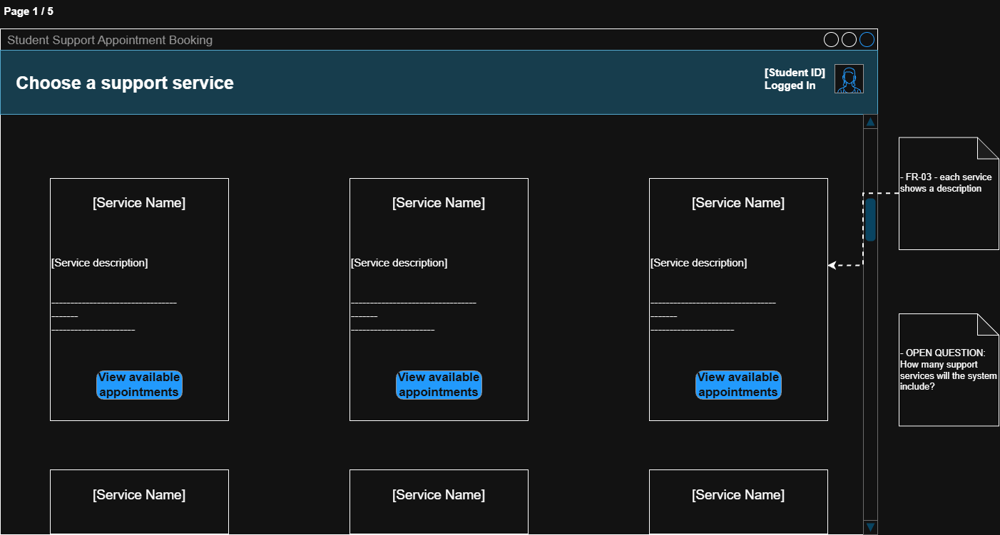
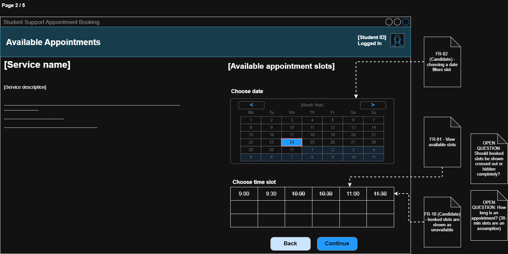
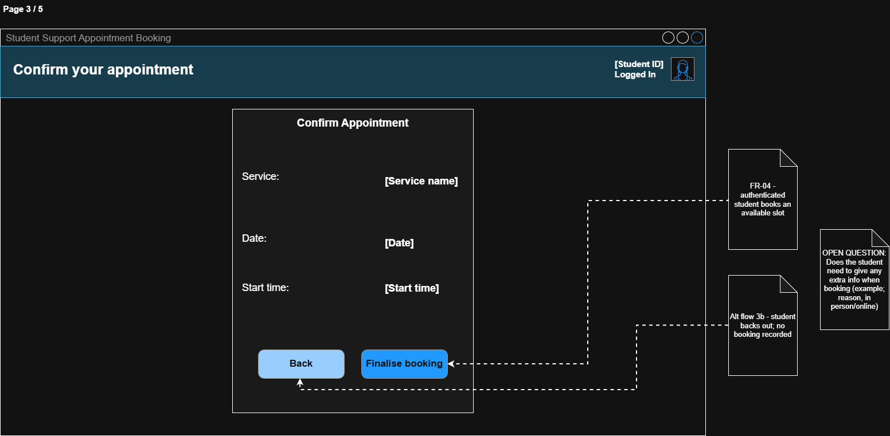
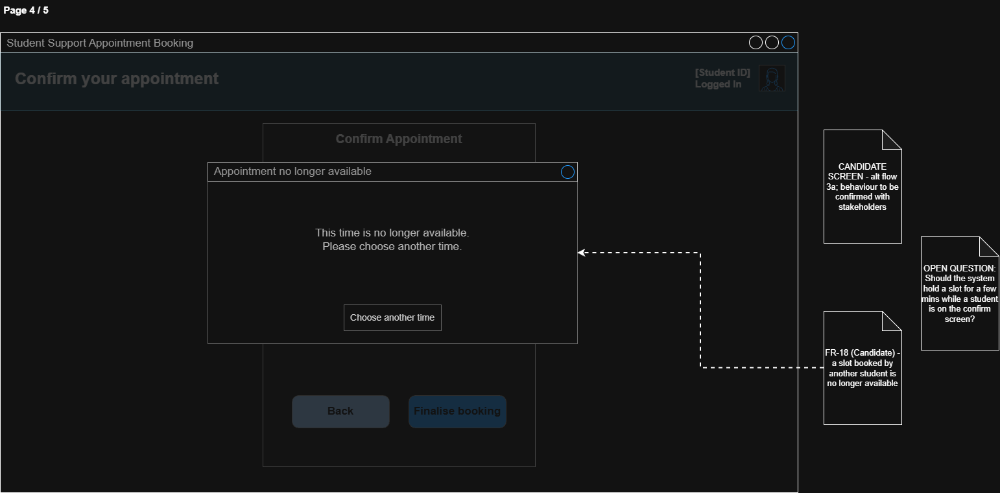
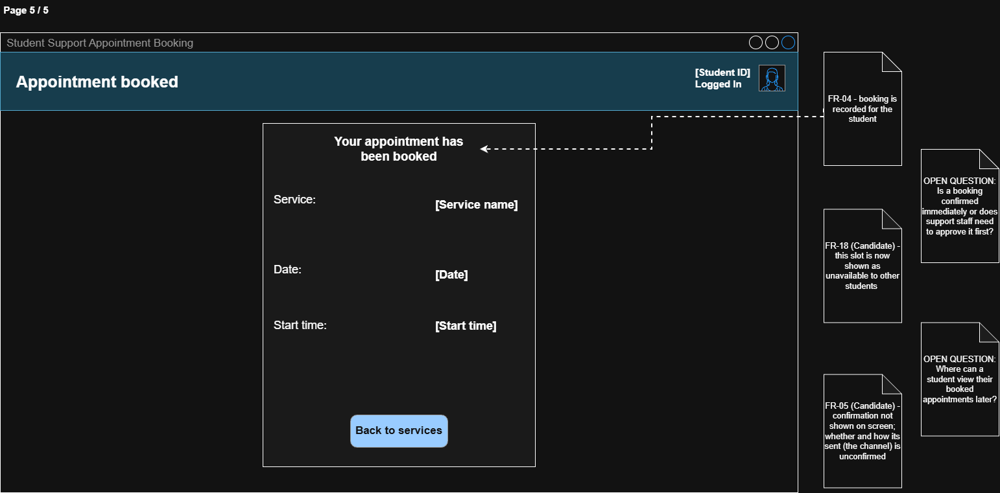

# Low-Fidelity Prototype

## Contents

1. [Journey and Purpose](#1-journey-and-purpose)
2. [Prototype Screens](#2-prototype-screens)
3. [Walkthrough, Findings and Improvements](#3-walkthrough-findings-and-improvements)

*[Back to README](/README.md)*

## 1. Journey and Purpose

This low-fidelity prototype models the main booking journey from use case **UC-02 (Book appointment)** where an authenticated student selects a support service then picks an available date and time slot and confirms their appointment. 
It explores the core supported requirements; **FR-01 (view available slots)**, **FR-03 (view service description)**  and **FR-04 (book an appointment)**, alongside candidate requirements; **FR-02 (filtering by date)** and **FR-18 (marking booked slots as unavailable)**.  The goal of this prototype was to check whether the booking flow makes sense in a step-by-step booking process, see how the edge cases like a slot being taken before confirmation ([screen 4](#screen-4---candidate-screen-appointment-unavailable)) behave and uncover missing details that are to be confirmed by stakeholders.

## 2. Prototype Screens

### Screen 1 - Choose a support service

### Screen 2 - Available Appointments

### Screen 3 - Confirm your appointment

### Screen 4 - Candidate screen; Appointment unavailable

### Screen 5 - Appointment booked

## 3. Walkthrough, Findings and Improvements

All findings come from a self-review carried out while building the screens. No stakeholder walkthrough took place, so none of these findings were validated by stakeholders.

| Review method | Finding or question | Action / status |
|---|---|---|
| Self-review | On [screen 1](#screen-1---choose-a-support-service), a "Book appointment" button on the service cards implied that booking happens before picking a date or a time. | Changed - renamed the button to "View available appointments" |
| Self-review | On [screen 3](#screen-3---confirm-your-appointment) the "Cancel" button on the confirmation screen was unclear, because it could be easily confused with cancelling an existing booking (FR-07). | Changed - renamed the button to "Back" |
| Self-review | On [screen 4](#screen-4---candidate-screen-appointment-unavailable) I originally added two buttons to the "Appointment no longer available" pop-up, which made the next step unclear. | Changed - simplified it by only adding one button named "Choose another time" |
| Self-review | On [screen 2](#screen-2---available-appointments), the calendar only filters slots by dates rather than dates and time slots. | Added - I added a timetable to display the specific time slots. |
| Self-review | On [screen 2](#screen-2---available-appointments), I drew the booked slots crossed out and set all time-slots in 30 minute intervals, even though the scenario does not specify the allocated length for the slots or how the unavailable appointments should be handled visually. | Open question - recorded on screen 2 in a note to be confirmed by the stakeholders |
| Self-review | On [screens 4](#screen-4---candidate-screen-appointment-unavailable)/[screen 5](#screen-5---appointment-booked), it is unclear whether a slot should be held temporarily while a student is confirming the booking, or if the bookings require staff approval before they are confirmed. | Open question - recorded on screen 4 and 5, in notes |
| Self-review | On [screen 5](#screen-5---appointment-booked) there is no way for a student to view their booked appointments later, even though FR-07 requires them to be able to cancel a booking. | Candidate requirement - added as [**FR-19 (Candidate)**](/03-requirements-analysis/requirements.md#4-functional-requirements) |
---

Reviewing the five screens showed me how easily small button labels such as "Book appointment" on screen 1 or "Cancel" on screen 3 could confuse the actual booking steps. Changing them made the flow much clearer.

Drawing the screens also made me realise I was making assumptions without noticing, like setting the time-slots to 30 minutes apart and crossing out the taken ones. On top of that, I spotted a missing requirement because students have no way to view their booked appointments before cancelling them, which led me to add a new functional requirement, **FR-19 (Candidate)**.

There are several questions that are still open and need stakeholder confirmation:
* the length of a slot
* whether booked slots should be hidden or shown as unavailable
* whether a slot should be held during confirmation
* whether bookings need staff approval

---
*[Back to top](#contents) | [Back to README](/README.md)*